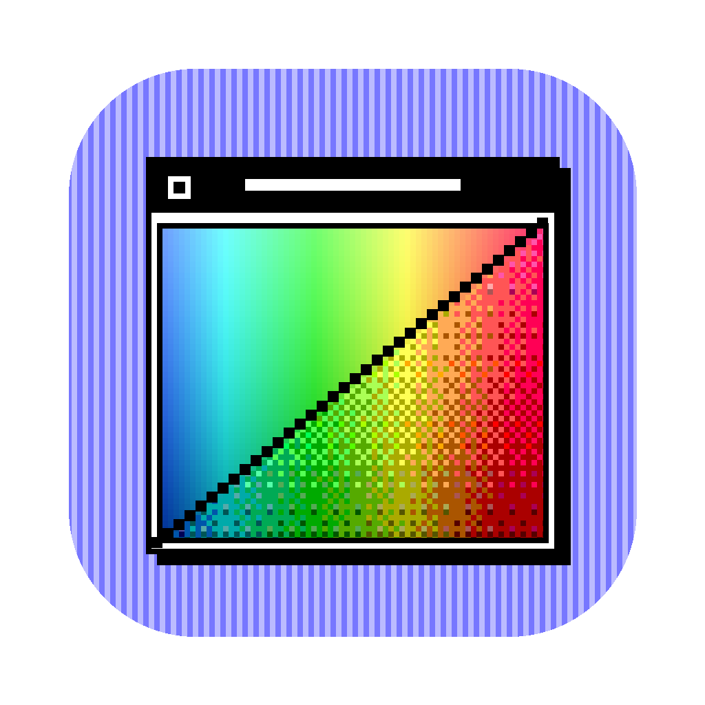
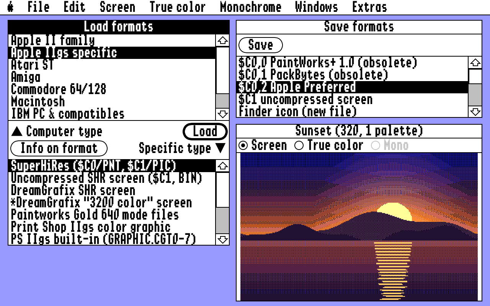
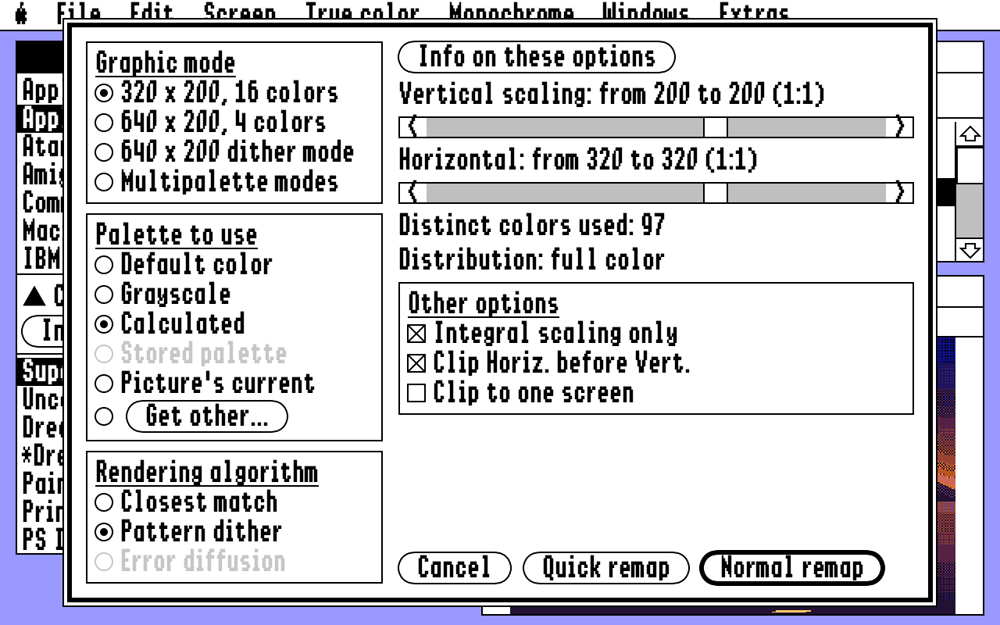
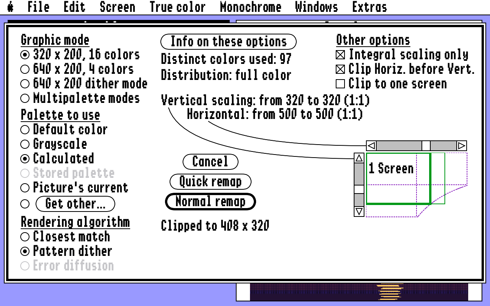
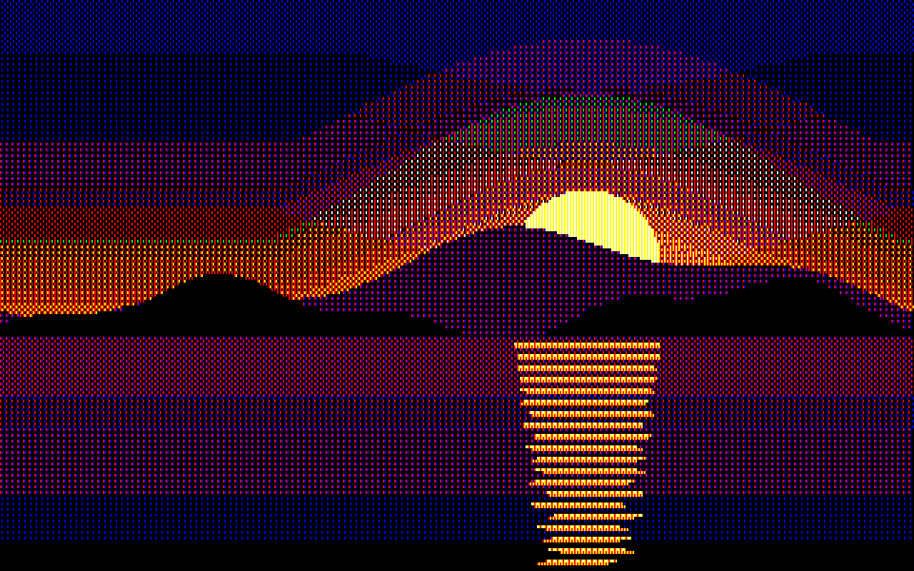
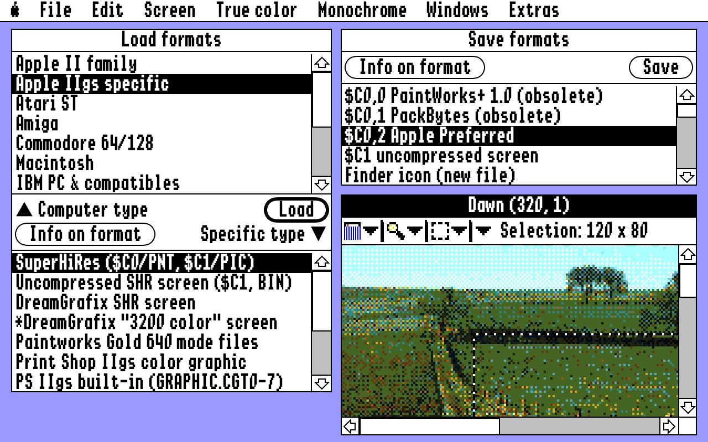
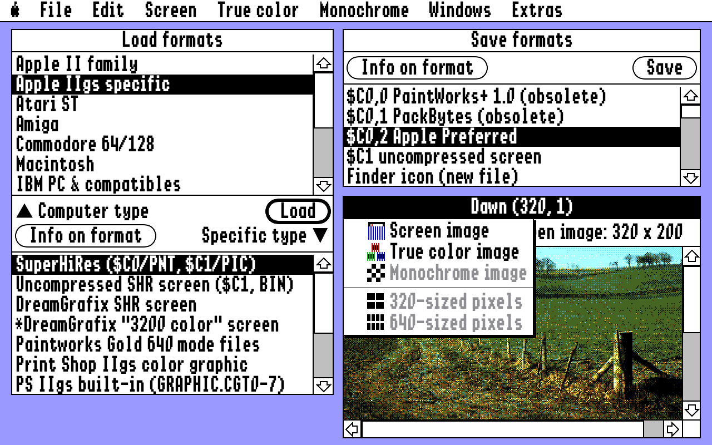
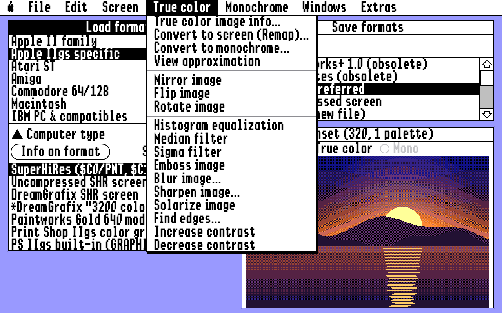
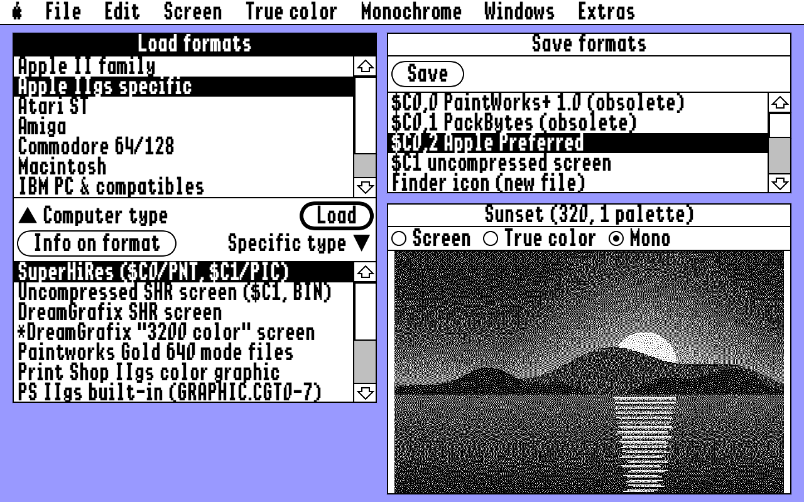

# GS Remap

A macOS port of SuperConvert 4.0 (Apple IIgs, Seven Hills Software) built by reverse
engineering the original program. The conversion engine is reimplemented in Swift from
the disassembly and the manual; the window mimics the IIgs desktop.

## Screenshots



The desktop: Load formats, Save formats and the Image window.



The Remap dialog: graphic mode, palette, rendering algorithm and scaling. The diagram shows
the resulting picture against a grid of screens; the curve is the 64K size limit.



A picture too large for the limit: the thin outline is the size asked for, the thick one is
what you get.



A landscape remapped to 640 x 200 dither mode with the default palette.



The Image window: a selection with marching ants, and the info bar with its pop-up menus
for image type, zoom, tool and actions (crop, discard).





The True color menu with its filters.



A tree silhouette as a monochrome image made with error diffusion.



## Layout

- `Sources/SCCore` — conversion engine (no UI): image types, palette calculator,
  pattern dither, error diffusion, SHR and Apple II file formats
- `Sources/sc4` — command-line front end, handy for batch work and testing
- `App` — the SwiftUI app
- `Tests` — unit tests
- `docs/RE-NOTES.md` — what was learned from the original code

## Build

To build the app in Xcode, open `GSRemap.xcodeproj` (not the folder or `Package.swift`,
which only give you the engine and the command-line tool) and run the GSRemap scheme.

From the command line:

```bash
swift test
xcodegen generate
xcodebuild -project GSRemap.xcodeproj -scheme GSRemap -derivedDataPath .build/xcode build
```

## Status

Working: Remap (320, 640, 640 dither, multipalette; default, greyscale, calculated,
stored, current and "Get other" palettes; closest match, pattern dither, error
diffusion; scaling and clipping), Quick remap, mirror/flip/rotate.

Image window, as in SuperConvert: an info bar with four pop-up menus (image type with
320- or 640-sized pixels, zoom from 1/8 to 8X, selection or pixel peek tool, and the actions
Crop to selection, Discard this image type and Discard other image types), scroll bars, a
selection with marching ants that snaps to whole bytes or pixels and can be moved, resized by
its edges and corners and set to the whole picture with a double click, and a pixel peek that
shows the palette, index and colour of the pixel under the pointer.

True colour filters: histogram equalization, median, sigma, emboss, blur, sharpen, solarize,
find edges, increase and decrease contrast.

Monochrome images: conversion from screen and true colour images (error diffusion, pattern
dither, halftone, 50% threshold; 1X, 2X or 4X size), conversion back to either, negative, info.

Load, Apple II: HiRes and Double HiRes (colour or black & white), Print Shop graphics,
ThunderScan raw scans, TDM 40- and 80-column text screens, Works of Art pages (Springboard
Publisher). Added from MegaconvertGS: LoRes and Double LoRes; HiRes and Double HiRes packed
with PackBytes, HiRes packed with fadden's LZ4FH; Double HiRes as NAME.BIN + NAME.AUX pairs
(Beagle Graphics, bmp2dhr) and bmp2dhr's .DHR picture pieces and .DHM masks.

Load, Apple IIgs: SHR ($C1, $C0/0, $C0/1, $C0/2 Apple Preferred), DreamGrafix (256 and
3200 colour), Paintworks Gold 640 mode files, Print Shop IIgs graphics and GRAPHIC.CGT
libraries, Finder icon files, AST and ComputerEyes digitizer data, 3200 colour pictures
(uncompressed, the $C0/$3200 packed form, and .3201 files).

Load, Atari ST: Degas, Degas Elite, Neochrome, Tiny, Spectrum 512 (.SPU and .SPC).

Load, Amiga: IFF ILBM, including Extra HalfBrite, HAM and 24-bit.

Load, Commodore 64: Doodle, Koala, Print Shop screens; from MegaconvertGS: Art Studio and
Interpaint hires, Advanced Art Studio, FLI Graph, Amica Paint.

Load, Macintosh: MacPaint (640 mode greys or 320 mode black & white), ScreenMaker; from
MegaconvertGS: QuickDraw pictures (PICT, version 1 and 2).

Load, IBM PC: BMP (via macOS), PC Paintbrush PCX, GEM / Ventura IMG, DeluxePaint LBM,
FliAway frame files.

Load, Unix: Sun Rasterfile, SGI Iris, Portable Pixelmap (PBM, PGM, PPM; text and binary).

Load, computer-independent: JPEG, PNG, GIF, TIFF via macOS; CompuServe RLE, IPI
(.R + .G + .B), QuickRayTracer raw files; from MegaconvertGS: Truevision Targa (TGA).

Load, from MegaconvertGS: Amstrad CPC screens in mode 0, 1 and 2 (with the AMSDOS header or
packed by OCP Art Studio, and the colours and mode of the .PAL file beside them); Atari 8-bit
MicroPainter, Graphics 8 and Graphics 9 screens; MSX Screen 2, 5, 7 and 8; ZX Spectrum
screens.

The formats added from MegaconvertGS give the same pixels as MegaconvertGS:
`Tests/crosscheck/megaconvert.py` loads MegaconvertGS's test pictures (written from known
pixels by its test suites) and compares every pixel, and `Tests/crosscheck/a2save.py`
compares the Apple II saves with MegaconvertGS's model of them byte for byte.

Save: $C0/0, $C0/1, $C0/2, $C1, Finder icon files (new or added to), rIcon resources (new
resource file or added to one), hex data, GIF, PNG, TIFF; from MegaconvertGS: BMP, and Apple
II HiRes, Double HiRes (colour or black & white), LoRes and Double LoRes screens, plain or
packed, dithered in the Apple II colours (error diffusion, a pattern or none; filling the
screen or keeping the picture's proportions). IIgs files get a `#C00002`-style
suffix so tools such as CiderPress and cadius set the ProDOS file type.

Menus: every item of the original is present. Working: help and menu item help (the help's
topics and every format's Info on format text come from MegaconvertGS's, adapted to the port;
`tools/make_format_info.py` makes `Sources/SCCore/FormatInfo.swift` from them), multiple-file loading with Load next, exchange load/save paths,
printing (normal, enhanced, alignment page), Examine file, paste, the half-size, X4 and
true colour views, use as desktop background, the font list and a system report.

Left dimmed, with the reason in Menu item help: Undo and Clear (desk accessories only on
the IIgs), View interlaced on VOC, Oscilloscope Art, Font key chart, Print banner.

Not ported: the desktop background INIT save format, New Print Shop files, and the
Babelfish translators.

## License

The source code is released under the MIT License (see `LICENSE`).

The fonts in `App/Fonts` are not covered by it. They are by Kreative Software and remain
under the Kreative Software Relay Fonts Free Use License (`App/Fonts/ShastonLicense.txt`),
which among other things does not allow selling copies of the fonts.

SuperConvert is a trademark of Seven Hills Software Corporation. GS Remap is an independent
project and is not affiliated with or endorsed by its authors.
